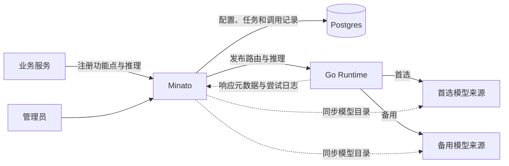

# 技术设计

本页概述产品架构。接口与运行时边界以详细设计为准。Minato 负责入口鉴权、路由版本和审计，低内存 Go Runtime 执行上游调用、协议转换和回退。LiteLLM 仅作为兼容数据平面的可选实现。 [详细设计](implementation/index.md)

## 架构与选型

Minato 在一个进程中运行控制台、管理 API、推理入口和后台任务。Go Runtime 使用内存路由快照，负责协议转换、访问上游和有界回退。Minato 通过内部路由发布接口推送版本。LiteLLM 可以作为迁移期兼容数据平面运行。 [LiteLLM 模型管理](https://docs.litellm.ai/docs/proxy/model_management)



推理入口固定本次请求所用的路由版本，Runtime 依序把可重试的失败切到下一个候选。目录同步、发布、重算、回放和清理各自串行处理任务，彼此独立运行。Runtime 重启后，Minato 会在请求缺少路由时按当前版本重新发布。默认部署共用一个 Postgres 实例，Runtime 不需要独立数据库。Minato 进程重启时，控制台和推理会一起短暂停顿。

## 注册与调用 API 草案

管理员创建项目和环境后签发环境 Key。业务凭该 Key 登记本环境内的功能点，并调用分配给本环境的推理别名。Minato 保存凭证指纹及环境范围，统一校验注册和推理。LiteLLM 使用内部凭证。所有上游凭证由管理员在管理侧维护，通过凭证引用关联到来源。

```http
PUT /minato/v1/projects/demo-app/environments/production/features/text-classification
Authorization: Bearer <project-environment-key>
Content-Type: application/json

{
  "preferredModel": { "sourceId": "demo-provider", "modelId": "example-model" },
  "requirements": { "endpoint": "responses", "minContextTokens": 32000 }
}
```

注册结果包含稳定的 `alias` 和 `routingStatus`。路由发布前状态为 `pending`，发布成功后为 `active`。同一功能点重复注册更新业务声明，管理员覆盖继续生效。业务按实际模型目录和请求需求填写模型 ID 与上下文阈值。路由激活后即可调用推理接口。

```http
POST /v1/responses
Authorization: Bearer <project-environment-key>
Content-Type: application/json

{
  "model": "demo-app.production.text-classification",
  "input": "将‘应用无法启动’分类为故障报告、功能建议或一般咨询。"
}
```

项目和环境标识由管理员创建，功能点标识由业务声明。服务端从凭证判断身份，并校验路径中的项目和环境。项目、环境和功能点标识使用小写字母、数字和连字符，`.` 用来拼接别名。运行时只允许 Key 访问已授权的功能点别名，内部模型组和管理端点限制在网关管理网络。

## 数据与模型目录

| 数据 | 设计 |
| --- | --- |
| 项目、环境和功能点 | 功能点由 `projectId + environment + featureId` 唯一确定。业务申报和管理员覆盖分别存储 |
| 来源与模型 | 来源包含提供方、接口、凭证引用和同步状态。按 `sourceId + modelId` 区分模型，保留上游 ID 的大小写与空格 |
| 路由策略 | 保存首选、备用顺序、默认池、能力约束和发布版本，记录操作人和时间 |
| 用量 | 按逻辑请求和上游尝试记录事件，关联功能点别名和实际模型 |
| 调用审计 | 以请求 ID 关联审计元数据和单独存放的请求、响应内容。记录采集状态、保留期限和权限范围 |
| 回放 | 新调用保存原请求 ID、发起人、所选路由或目标模型、测试结果及用量 |

每个来源使用独立目录适配器。CPA 和兼容网关读取来源的 `/v1/models`。OpenCode Zen 和 Go 分开维护目录、凭证和按模型区分的 API 端点。一次同步失败保留上次成功快照并标记过期。模型持续从多次成功快照中缺失后标记下架，发布更新时从自动候选中剔除。管理员可以登记已验证但未列出的模型 ID。 [OpenCode Zen](https://opencode.ai/docs/zen/) · [OpenCode Go](https://opencode.ai/docs/go/)

目录负责记录模型是否被列出。调用结果和可选的低频探测提供健康信号。能力信息优先采自来源元数据，对缺失的协议、上下文和输出格式信息允许管理员补录。只有满足功能点约束的候选才进入自动回退池。 [LiteLLM 健康检查](https://docs.litellm.ai/docs/proxy/health)

## 路由和发布

1. 管理服务按「管理员首选或业务预设 → 功能点备用列表 → 满足能力约束的默认模型池」生成候选顺序。默认池由管理员选定。若无兼容模型，网关返回可诊断的错误。
2. Runtime 对配置允许的连接失败、限流、上游临时故障或明确的模型不可用错误执行有界回退。每次请求使用一个版本化 Runtime 路由键。请求参数错误直接返回。同一请求在写出第一个流式数据后发生错误时结束该流。
3. 管理服务保存期望版本和当前生效版本。先准备并读回验证完整的候选模型组，再事务性切换功能点的生效版本。准备失败时沿用此前生效的版本。
4. 目录同步与推理解耦。目录过期或 Minato 管理服务重启时，Runtime 继续使用内存中的最近一次路由配置。Runtime 丢失路由后由 Minato 按当前生效版本懒加载恢复。为路由发布保留历史，供管理员回滚。

使用固定版本的 LiteLLM 验证原生 Responses 转发到 CPA。备用来源仅提供 Chat Completions 时，验证网关能否转换请求和响应、转发来源所需的会话头（例如 `x-opencode-session`），并保留 JSON 输出与 usage。已有业务迁移时，先验证网关回退，再移除对应的业务侧重试和回退。 [LiteLLM Responses API](https://docs.litellm.ai/docs/response_api)

## 用量与管理页

使用网关生成的请求 ID 关联业务请求与上游尝试。业务请求量按请求 ID 汇总，供应商耗用量按尝试去重汇总。记录实际来源及模型、状态、回退原因、延迟，以及上游返回的输入、输出和可选的缓存及推理 token。流式中断时保留已收到的 usage，缺失字段显示未知。成本字段可按实际账单、估算、未知区分。CPA Usage Keeper 保留账号配额和凭证状态的视角。 [CPA Usage Keeper](https://github.com/willxup/cpa-usage-keeper) · [Sub2API](https://github.com/Wei-Shaw/sub2api)

管理页包含项目、模型来源、用量和调用记录入口。项目页按环境管理 Key、功能点及内容审计设置，展示预设、覆盖、当前候选与发布版本。来源页可查看同步时间、目录差异和健康状态。用量页可按时间、功能点和调用类型筛选，并跳转到具体请求的审计记录。

## 调用审计

内容审计默认关闭。网关在请求开始时根据已鉴权的项目环境读取采集策略。开启后，为每个网关接收的推理请求创建一条审计记录，关联实际的上游尝试。记录客户端所见的接口、请求体、响应体或错误、状态码和时间，以及每次尝试对应的模型、延迟和 usage。流式调用根据协议事件重建客户端收到的输出，中断时保留已输出部分和终止原因。

Minato 推理入口采集客户端请求和响应，LiteLLM 的回调提供上游尝试和 usage。通过同一请求 ID 关联原始请求、客户端响应、流式终止和回退尝试。采集事件异步持久化，按请求和事件标识去重。丢失或超限时记录采集状态并提供失败计数，使业务响应可以继续返回。

内容和用量分别存放，正文受项目环境访问权限和保留期约束。记录前过滤认证头和凭证，支持项目设置内容脱敏规则，并按大小限制标注截断。只有拥有该环境内容查看权限的成员可以读取或复制正文。Prompt 复制保留消息顺序与角色，完整请求复制保留已采集且允许导出的参数。关闭采集仅影响后续调用，已有内容按保留期清理。

## 回放测试

调用详情提供「复制 Prompt」「复制请求 JSON」「回放」操作。测试编辑页支持新建请求，也可以从原记录加载接口、请求和参数，允许修改 Prompt、参数和目标模型。具有环境测试权限的操作者可以按功能点当前生效的路由测试，也可以指定该环境允许使用的兼容模型。从历史记录载入还需该记录的内容查看权限。页面显示将发送的内容和目标，提交后通过同一网关执行，沿用环境权限和限额。跨协议时按已验证的适配规则转换。

回放是一笔带 `replayOf` 的新推理请求。回放记录保存发起人、所选目标、实际模型、输出、耗时和 token，提供与原调用的并排对照。测试用量可独立筛选，并计入实际供应商用量。原始调用记录保留供对照。依赖 `previous_response_id`、已失效的附件或外部会话状态时，编辑页提示补齐上下文。工具定义和历史工具结果可以随请求回放，测试端仅展示本次模型返回的工具调用。

## 部署与迁移

- 本地先用容器运行 LiteLLM、Minato 和 Postgres，验证 CPA 的实际模型 ID、Responses 和备用协议转换。选择一个固定 LiteLLM 版本，验证虚拟 Key 权限、动态回退配置、请求和尝试用量的可观测性。
- Docker Compose 可部署到本地或云服务器。容器托管平台需要支持常驻服务和持久化 Postgres。部署选择依据上游连通性、跨地域延迟和流式超时。云端网关可通过私有连接访问本地模型来源，本地离线时回退到可用的备用来源。
- 先用模拟上游覆盖模型下架、网络断开、目录异常、回退、流式中断和路由回滚，再用测试项目和示例请求验证 CPA 与 OpenCode 适配器。已有兼容网关可按需登记为上游来源。
- 用非流式、流式、回退和失败样本验证审计字段、复制结果、内容清理及跨环境权限。回放测试覆盖当前路由、指定模型和修改 Prompt，并核对原调用关联与用量计数。

业务验收见 [产品需求](requirements.md#首版验收)。
