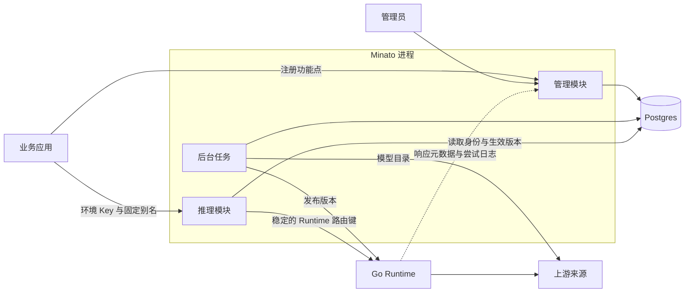

# Minato 详细设计

Minato 把上游模型变化与业务发布解耦。业务使用稳定的功能点别名，管理员负责模型策略。Minato 选择候选，Go Runtime 转换协议并执行回退。调用审计与回放用于定位异常和验证换模。

| 文档 | 内容 |
| --- | --- |
| [接口与数据](api-data.md) | API 契约、权限、数据库约束、密钥和错误模型 |
| [目录、路由与推理](routing.md) | 模型发现、能力筛选、版本发布、失败处理和协议边界 |
| [审计、用量与回放](audit-replay.md) | 采集方式、用量对账、测试执行和数据保留 |
| [实现与验收](delivery.md) | 管理界面、部署拓扑、实现顺序和验收用例 |

## 首版的实现选择

| 组件 | 技术与职责 |
| --- | --- |
| Minato | TypeScript + Fastify，单进程提供管理、注册、推理和控制台。后台任务在单独的执行循环中运行 |
| Go Runtime | 独立的低内存 Go 服务，接收版本化路由快照，负责单次上游调用、协议转换和有序回退 |
| Postgres | 保存控制配置、审计元数据、内容、任务和用量。Runtime 不需要独立数据库 |
| 管理界面 | React + Vite，随管理服务同源提供，使用 Lucide 图标 |

首版提供文本 Chat Completions 和 Responses、单次测试和回放。批量回放、评测集、自动评分和发布门禁留给下一阶段。所有示例使用虚构的项目、模型和来源。

## 运行边界

推理模块每次读取已发布版本。数据库不可用时，推理返回 `503`。审计异步写入失败有独立计数，已开始的推理流继续返回。所有 Minato 模块共用一个进程和数据库连接池，Runtime 通过响应头返回选中来源和尝试日志。

详细设计中的接口、状态和默认值是实现约定。底座验证使用 LiteLLM `v1.85.0` 固定摘要。 [本地验证结果](../../tools/litellm-compat/README.md) · [兼容性验收](delivery.md#兼容性验证)
