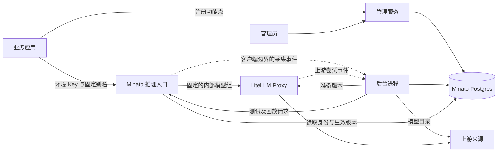

# Minato 详细设计

Minato 把上游模型变化与业务发布解耦。业务使用稳定的功能点别名，管理员负责模型策略。Minato 选择候选并执行回退，LiteLLM 转换协议并访问上游。调用审计与回放用于定位异常和验证换模。

| 文档 | 内容 |
| --- | --- |
| [接口与数据](api-data.md) | API 契约、权限、数据库约束、密钥和错误模型 |
| [目录、路由与推理](routing.md) | 模型发现、能力筛选、版本发布、失败处理和协议边界 |
| [审计、用量与回放](audit-replay.md) | 采集方式、用量对账、测试执行和数据保留 |
| [实现与验收](delivery.md) | 管理界面、部署拓扑、实现顺序和验收用例 |

## 首版的实现选择

| 组件 | 技术与职责 |
| --- | --- |
| Minato 管理服务 | TypeScript + Fastify，提供管理和注册 API。后台进程运行目录同步、发布、采集写入和回放任务 |
| Minato 推理入口 | 同一 TypeScript 项目的独立进程，负责环境 Key 鉴权、请求 ID、解析别名、流式透传与内容采集 |
| LiteLLM Proxy | 使用固定版本的官方镜像，部署在私有网络，负责单次上游调用和协议转换。Minato 推理入口按错误类型执行有序回退 |
| Postgres | 控制配置、审计元数据、内容、任务和用量。Minato 与 LiteLLM 设置独立数据库角色和数据边界 |
| 管理界面 | React + Vite，随管理服务同源提供，使用 Lucide 图标 |

首版提供文本 Chat Completions 和 Responses、单次测试和回放。批量回放、评测集、自动评分和发布门禁留给下一阶段。所有示例使用虚构的项目、模型和来源。

## 运行边界

推理入口读取已发布版本，独立于管理服务进程。控制配置和鉴权数据库不可用时，推理入口返回 `503`。审计内容的异步写入异常有独立状态和计数，已开始的推理流继续返回。平台管理员在私有网络维护 LiteLLM 管理入口。

详细设计中的接口、状态和默认值是实现约定。底座验证使用 LiteLLM `v1.85.0` 固定摘要。 [本地验证结果](../../tools/litellm-compat/README.md) · [兼容性验收](delivery.md#兼容性验证)
